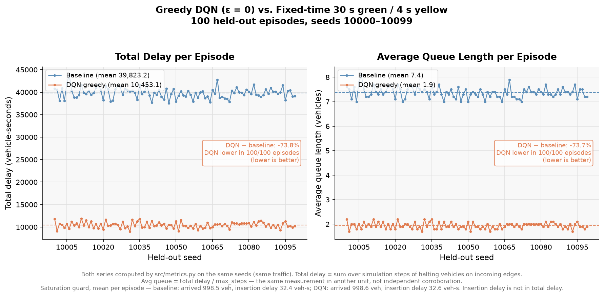

# TLCS — Deep Q-Learning Agent for Traffic Signal Control

A Deep Q-Learning agent that controls the traffic light of a single 4-way
intersection in the [SUMO](https://eclipse.dev/sumo/) traffic simulator, choosing
one of four green phases at each decision step to reduce vehicle delay.

## Results

**Greedy evaluation (ε = 0) on 100 held-out episodes**, seeds 10000–10099.
Training used seeds 0–299, so none of these traffic patterns was seen during
training. The agent is the final model after **300 training episodes**. Each
baseline runs on the **same 100 seeds**, so every episode compares the
controllers on identical traffic.

| Controller | Avg queue length (vehicles) | Total delay (vehicle-seconds) |
|---|---|---|
| Fixed-time, 30 s green / 4 s yellow (`intersection/environment.net.xml`) | 7.37 ± 0.22 | 39,823 ± 1,170 |
| Fixed-time, 10 s green / 4 s yellow (the agent's own phase lengths) | 3.31 ± 0.14 | 17,863 ± 729 |
| **DQN agent, greedy** | **1.94 ± 0.13** | **10,453 ± 647** |

Mean ± standard deviation over the 100 episodes.

**Queue length against the fixed-time baseline (30 s / 4 s): the agent's
average queue is 5.44 vehicles shorter (−73.7%, 95% CI −5.48 to −5.39),
and shorter in all 100 of 100 held-out episodes.** Against the stronger 10 s /
4 s fixed cycle it is 1.37 vehicles shorter (−41.4%, 95% CI −1.40 to −1.34),
again in 100 of 100 episodes. Total delay moves the same way: −73.8% and −41.5%.
Average queue is total delay divided by episode length, so the two are one
measurement in two units, not independent evidence.



The chart against the 10 s / 4 s cycle is in
[`results/dqn-300ep/comparison_10-4/`](results/dqn-300ep/comparison_10-4/comparison.png).

**Saturation check.** `total_delay` only sees vehicles that are on the
network, so it would understate delay if vehicles queued outside a full approach.
They did not. Per episode, 998.65 (agent) vs 998.54 (both baselines) of 1,000
vehicles arrived, and the delay spent waiting to enter the network was 32.6
vs 32.4–32.5 vehicle-seconds, under 0.3% of total delay. Equal arrival counts
also mean the agent did not shorten queues by starving one approach.

### What these numbers do and do not show

- **One training run.** Training was not repeated with other random seeds, so
  run-to-run variance of the training itself is unmeasured. The ± and CIs above
  describe variation across traffic seeds for this one trained policy.
- **Not shown to be converged.** Mean training-episode delay was still falling at
  episode 300 (34,877 for episodes 1–50, 11,504 for 251–300).
- **One demand scenario.** Training and evaluation traffic come from the same
  generator: 1,000 vehicles over 5,400 s, Weibull departures, 25% turning. The
  result says nothing about other demand levels or patterns.
- **Untuned baselines.** Both baselines are fixed cycles with equal green times.
  Neither is a tuned fixed-time plan (e.g. Webster) nor an actuated or
  max-pressure controller, and either of those could be stronger. The 10 s / 4 s
  cycle is included because, at this demand, it already halves the delay of the
  30 s / 4 s plan. Reporting only against 30 s / 4 s would overstate what the
  agent learned.
- **Simulation only.** No claim is made about a real intersection.

Everything behind these numbers — weights, per-episode data, logs, exact
commands — is in [`results/dqn-300ep/`](results/dqn-300ep/). The chart and
statistics regenerate byte-for-byte from a clean clone, and so does the
evaluation itself.

Earlier charts that compared against a 100-second-yellow signal plan, or that
mixed units between the two sides, are withdrawn. See
[`comparison/archive/README.md`](comparison/archive/README.md).

## How it works

- **State:** each of the 8 incoming lane groups is cut into 10 cells. For each
  cell the agent sees occupancy, mean speed and mean waiting time (240 inputs).
- **Actions:** 4 green phases (N–S, N–S left, E–W, E–W left). A green phase lasts
  10 s, and switching inserts a 4 s yellow.
- **Reward:** the decrease in accumulated waiting time of vehicles on the
  incoming roads between decisions.
- **Learner:** DQN with experience replay, an MLP with five 400-unit hidden
  layers, Huber loss and a
  Polyak-averaged target network (τ = 0.005), with ε-greedy exploration decaying
  linearly from 1 to 0.
- **Metric:** `src/metrics.py` defines every reported number, and both the agent
  and the baseline are scored by it. `total_delay` = Σ over 1-second steps of
  halted vehicles on the incoming roads.

## Reproduce

Requires [SUMO](https://eclipse.dev/sumo/) with `SUMO_HOME` set, and Python 3.13.
Run everything from the project root, one SUMO command at a time (each episode
rewrites `intersection/episode_routes.rou.xml`).

```bash
pip install -e ".[dev]"

# Train (≈35 min on a 12-core CPU; no GPU needed)
python src/train.py --settings settings/training_settings.yaml --out model/dqn-300ep

# Greedy evaluation on the 100 held-out seeds
python src/test.py --model model/dqn-300ep

# Fixed-time baselines on the same seeds
python comparison/run_baseline.py --config settings/testing_settings.yaml --out baseline_results
python comparison/run_baseline.py --config settings/testing_settings.yaml --out baseline_results_10-4 --green 10 --yellow 4

# Paired comparison: chart, table, comparison_summary.json
python comparison/compare_results.py --baseline baseline_results --rl model/dqn-300ep/test --out comparison_output
python comparison/compare_results.py --baseline baseline_results_10-4 --rl model/dqn-300ep/test --out comparison_output_10-4

# Measurement checks
python comparison/fixed_phase_check.py   # agent path and SUMO path agree: 18,195 veh-s, PASS
pytest -q
```

Training is not seeded, so a new training run gives a different policy. To check
the published numbers, evaluate the committed weights:
`python src/test.py --model results/dqn-300ep --settings results/dqn-300ep/testing_settings.yaml`.

Headless runs use `libsumo` (SUMO inside the Python process); `gui: true` in a
settings file switches to TraCI and `sumo-gui`. A Vietnamese guide to the same
pipeline is in [`comparison/HUONG_DAN_CHAY.md`](comparison/HUONG_DAN_CHAY.md).

## Credits

This project is derived from **TLCS** by Andrea Vidali,
["Deep Q-Learning Agent for Traffic Signal Control"](https://github.com/AndreaVidali/Deep-QLearning-Agent-for-Traffic-Signal-Control)
(MIT License, Copyright (c) 2019 Andrea Vidali). The intersection network, the
state discretisation and the original DQN training loop come from that project.
The changes made here include the shared metric definitions, the fixed-time
baseline comparison, the saturation guard and the libsumo/subscription data
path; see the git history.

## License

MIT. See [LICENSE](LICENSE), which names both copyright holders.
