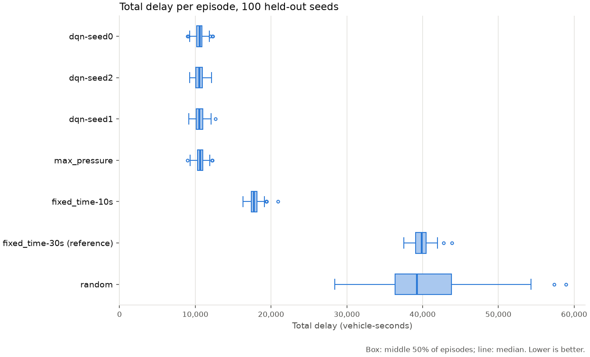

<div align="center">

# Traffic Signal Control with Deep Reinforcement Learning

**A Deep Q-Network that runs a traffic light in the SUMO simulator, tested against
fixed-time, max-pressure and random controllers on traffic it has never seen.**

[Results](#results) · [Quickstart](#quickstart) · [The MDP](#the-mdp) ·
[Reproduce](#reproduce-the-results) · [Extend it](#extending-it)

</div>

This is a reference reinforcement-learning project. A DQN agent controls the traffic light
of a 4-way intersection in the [SUMO](https://eclipse.dev/sumo/) traffic
simulator. It is compared with fixed-time, max-pressure and random controllers
on traffic it has never seen.

It is meant as a starting point for an RL course project or a thesis. It is small enough to read
in an afternoon and has a Gymnasium environment, a ~30-line DQN update, three
baselines, and an evaluation protocol designed to give trustworthy results (held-out
seeds, one metric definition for every controller, paired confidence intervals,
several training seeds).

### Highlights

- **Gymnasium environment** around SUMO: `reset(seed)` / `step(action)`, a
  240-dim observation, 4 green-phase actions, headless via `libsumo`.
- **Readable DQN** in PyTorch: replay buffer, Polyak-averaged target network,
  Huber loss, ε-greedy exploration.
- **Strong baselines**: max-pressure (Varaiya, 2013), two fixed-time plans and
  random, all run through the same environment and scored by the same metric.
- **Honest evaluation**: 100 held-out traffic seeds, paired 95% confidence
  intervals, 3 training seeds, and checks that no controller lowers its delay by
  keeping vehicles out of the network.
- **Reproducible**: seeded training is bit-for-bit repeatable on CPU. Trained
  weights, logs and per-episode data are committed in [`results/`](results/).
- **Tested**: 53 unit tests that need neither SUMO nor a GPU, plus an
  end-to-end check against SUMO's own signal program.

### Contents

- [Results](#results)
- [Quickstart](#quickstart)
- [The MDP](#the-mdp)
- [The agent](#the-agent)
- [Baselines](#baselines)
- [Evaluation protocol](#evaluation-protocol)
- [Reproduce the results](#reproduce-the-results)
- [Project layout](#project-layout)
- [Extending it](#extending-it)
- [Limitations](#limitations)

## Results

Greedy evaluation (ε = 0) on **100 held-out traffic seeds** (10000–10099; training
used 0–299). Every controller drives the same vehicles. DQN was trained three
times with different seeds, 300 episodes each.

| Controller | Total delay (vehicle-seconds) | Average queue (vehicles) |
|---|---|---|
| Random | 40,511 ± 6,248 | 7.50 |
| Fixed-time, 30 s green / 4 s yellow | 39,823 ± 1,170 | 7.37 |
| Fixed-time, 10 s green / 4 s yellow | 17,863 ± 729 | 3.31 |
| Max-pressure | 10,669 ± 574 | 1.97 |
| **DQN** (3 training runs) | **10,540** (runs: 10,522 / 10,563 / 10,536) | **1.95** |

Mean ± standard deviation over the 100 episodes. Lower is better.

**DQN beats max-pressure, but narrowly:** 129 vehicle-seconds less delay per
episode (−1.2%; 95% CI −181 to −77 across the three training runs). Each run on
its own is better than max-pressure on the paired per-seed comparison, and has
lower delay in 58–60 of the 100 episodes. Against the fixed-time plans the
difference is large (−41% vs the 10 s cycle, −74% vs the 30 s plan), but at this
demand the 30 s plan is no better than choosing phases at random, so it is a weak
reference.



All controllers let 998.5–998.7 of the 1,000 vehicles finish their trip, with
about 32 vehicle-seconds of insertion delay, so no controller lowered its delay by
keeping vehicles out of the network.

What this does and does not show:

- The learned policy is about as good as a strong hand-designed rule, slightly
  better. It is not a large improvement over good traffic engineering.
- Training was not run to convergence: training-episode delay was still falling
  at episode 300.
- One intersection, one demand level, simulation only (see
  [Limitations](#limitations)).

Weights, logs, per-episode data and exact commands:
[`results/dqn-3seeds/`](results/dqn-3seeds/). An earlier single-seed run,
evaluated only against fixed-time plans, is kept in
[`results/dqn-300ep/`](results/dqn-300ep/).

## Quickstart

Requires Python 3.13 and [SUMO](https://eclipse.dev/sumo/) with `SUMO_HOME` set
(e.g. `pip install eclipse-sumo` and `export SUMO_HOME=$(python -c "import sumo; print(sumo.SUMO_HOME)")`).
Run everything from the project root.

```bash
git clone https://github.com/TranBaDat2607/traffic-signal-control-rl.git
cd traffic-signal-control-rl
pip install -e ".[dev]"
pytest -q                                   # 53 unit tests, no SUMO needed
python comparison/fixed_phase_check.py      # end-to-end check with SUMO: prints PASS
```

A five-minute tour of the whole pipeline is in
[`notebook/quickstart.ipynb`](notebook/quickstart.ipynb). From the command line:

```bash
python src/train.py --episodes 10 --out runs/train/smoke       # ~2 min
python src/evaluate.py dqn --model runs/train/smoke --episodes 5
python src/evaluate.py max_pressure --episodes 5
```

The environment is a regular Gymnasium environment:

```python
from pathlib import Path
from environment import Environment

env = Environment(n_cars_generated=1000, max_steps=5400, green_duration=10,
                  yellow_duration=4, turn_chance=0.25,
                  sumocfg_file=Path("intersection/sumo_config.sumocfg"))
obs, info = env.reset(seed=0)            # the seed decides the traffic
obs, reward, terminated, truncated, info = env.step(2)   # 2 = east-west green
env.close()
```

## The MDP

| | |
|---|---|
| **Decision step** | Every 10 simulated seconds the agent picks the next green phase. If it differs from the current one, a 4 s yellow is inserted first, so a step lasts 10 s or 14 s. |
| **Actions** (4) | Green for north–south through/right, north–south left, east–west through/right, east–west left. |
| **State** (240) | Each of the 8 incoming lane groups is cut into 10 cells, short near the stop line and long far from it (7 m … 350 m). Per cell: occupied (0/1), mean speed / 25 m/s, mean waiting time / 400 s. |
| **Reward** | The decrease in the total accumulated waiting time of vehicles on the incoming roads over the step. Negative while queues grow, positive when waiting vehicles leave. |
| **Episode** | 5,400 s (1.5 h) with 1,000 vehicles; departure times follow a Weibull distribution (a peak), 75% go straight. The traffic seed passed to `reset()` decides every vehicle. |
| **Termination** | None. The episode is cut by a time limit, which `step()` reports as `truncated`, so the agent keeps bootstrapping from the last state. |
| **Discount** | γ = 0.75 per decision step: an effective horizon of about 4 steps (≈ 1 min). |

Code: [`src/environment/core.py`](src/environment/core.py) (dynamics, reward),
[`src/environment/state.py`](src/environment/state.py) (observation).

## The agent

DQN (Mnih et al., 2015) in [`src/agent/agent.py`](src/agent/agent.py):

- MLP 240 → 400 → 400 → 400 → 400 → 400 → 4 (ReLU), Adam, learning rate 1e-3, Huber loss.
- Experience replay: 50,000 transitions, learning starts after 600, batch 100,
  one gradient step per environment step.
- Target network updated by Polyak averaging, τ = 0.005 per gradient step.
- Target `y = r + γ (1 − terminated) max_a' Q_target(s', a')`.
- ε-greedy exploration, ε decaying linearly from 1 to 0 over training.
- 300 training episodes on traffic seeds 0–299.

All hyperparameters are in
[`settings/training_settings.yaml`](settings/training_settings.yaml). Unknown keys
are rejected, and each run saves the settings it actually used.

## Baselines

All baselines act through the same environment as the agent: a decision every
10 s and a 4 s yellow on every change. Only the decision rule differs.
[`src/policy/baselines.py`](src/policy/baselines.py):

- **Random**: a uniformly random phase at every decision. A floor.
- **Fixed-time**: a fixed cycle through the four phases. 30 s green is the plan in
  the network file; 10 s green is the shortest cycle the action timing allows, and
  at this demand it is much better. A fixed-time controller run through the
  environment gives exactly the same delay as SUMO running the same static program
  itself (`comparison/fixed_phase_check.py`).
- **Max-pressure** (Varaiya, 2013): green for the phase with the most halted
  vehicles on its incoming lanes minus those on its outgoing lanes. The standard
  adaptive heuristic in the traffic-signal-control literature, and the baseline a
  learned controller should be expected to beat.

## Evaluation protocol

[`src/evaluate.py`](src/evaluate.py) and
[`comparison/compare_results.py`](comparison/compare_results.py):

1. **Held-out traffic.** Every controller runs on the same 100 traffic seeds,
   10000–10099. Training uses seeds 0–299.
2. **Greedy agent.** The DQN is evaluated with ε = 0.
3. **One episode loop, one metric.** The agent and every baseline go through
   `episode.run_episode()` and are scored by
   [`src/metrics.py`](src/metrics.py). The main metric is **total delay**: halted
   vehicles on the incoming roads, summed over every simulated second
   (vehicle-seconds). Average queue = total delay / 5,400 s. The reward is a
   training signal and is never compared across controllers.
4. **Paired comparison.** Because every controller sees the same vehicles, the
   comparison uses the per-seed difference, with a 95% t-interval and a count of
   episodes won (`src/evaluation_stats.py`).
5. **Training variance.** The DQN is trained with three seeds. The spread across
   those runs is reported separately from the spread across traffic.
6. **Saturation guard.** Total delay cannot see vehicles that could not enter a
   full road. `vehicles_arrived` and `insertion_delay` (vehicle-seconds spent
   waiting to enter) are reported with every result.

## Reproduce the results

About 1.5 hours on a laptop CPU (8 cores), no GPU needed. From the project root:

```bash
# Train three runs (in parallel: one process each, 2 threads each)
for s in 0 1 2; do python src/train.py --seed $s --threads 2 --out runs/train/dqn-seed$s & done; wait

# Evaluate on the 100 held-out seeds
for s in 0 1 2; do python src/evaluate.py dqn --model runs/train/dqn-seed$s; done
python src/evaluate.py fixed_time --green 30
python src/evaluate.py fixed_time --green 10
python src/evaluate.py max_pressure
python src/evaluate.py random

# Paired comparison against the 30 s fixed-time plan
python comparison/compare_results.py runs/eval/fixed_time-30s runs/eval/fixed_time-10s \
    runs/eval/max_pressure runs/eval/random \
    runs/eval/dqn-seed0 runs/eval/dqn-seed1 runs/eval/dqn-seed2 --out runs/comparison
```

Training is seeded: the same `--seed` and `--threads` on a CPU reproduce a run bit
for bit. The published runs, with weights, logs and per-episode data, are in
[`results/`](results/). To check the published numbers without training, evaluate
the committed weights, e.g.
`python src/evaluate.py dqn --model results/dqn-3seeds/train/dqn-seed0`.

A Vietnamese version of this section is in
[`comparison/HUONG_DAN_CHAY.md`](comparison/HUONG_DAN_CHAY.md).

## Project layout

```
src/
├── environment/      the MDP: Gymnasium Environment, state, reward, traffic generator
├── agent/            DQN: update rule, Q-network, replay memory
├── policy/           Controller interface, baselines, epsilon-greedy
├── episode.py        the one episode loop used by everything
├── metrics.py        the one definition of every reported number
├── evaluation_stats.py   paired differences and confidence intervals
├── train.py          train the DQN
├── evaluate.py       evaluate any controller on held-out seeds
└── grid/, grid_train.py  experimental multi-agent grid (not in the evaluation pipeline)
comparison/           compare_results.py, fixed_phase_check.py, archive/
settings/             training and evaluation settings
intersection/         the SUMO network
results/              published runs
tests/                unit tests (no SUMO needed)
docs/extending.md     how to add a controller, an algorithm, a reward; project ideas
```

## Extending it

[`docs/extending.md`](docs/extending.md) covers adding a controller, training
another algorithm (e.g. PPO through Stable-Baselines3), changing the reward,
state, demand or network, a checklist for a credible result, and project ideas.

The shortest version: a controller is any class with `reset()` and
`choose_action(state, info) -> int`, and `evaluate.evaluate(controller, settings)`
scores it exactly like everything else.

## Limitations

- **One intersection, one demand pattern.** The results say nothing about other
  demand levels, other geometries, or networks of signals.
- **Simulation only.** No claim is made about a real intersection.
- **Restricted timing.** Every controller, baselines included, switches only at
  10 s boundaries with a fixed 4 s yellow. A real actuated controller has finer
  control.
- **Baselines are not tuned beyond what is listed.** Max-pressure and the 10 s
  cycle are strong, but a Webster-optimised plan or a tuned actuated controller
  could be stronger still.
- **Limited training budget.** Three seeds of 300 episodes each.

## Citation

If this project helps your work, please cite it (GitHub's "Cite this repository"
button reads [`CITATION.cff`](CITATION.cff)):

```bibtex
@software{tran_traffic_signal_control_rl,
  author = {Tran, Ba Dat},
  title  = {Traffic Signal Control with Deep Reinforcement Learning},
  url    = {https://github.com/TranBaDat2607/traffic-signal-control-rl},
  year   = {2026},
  note   = {DQN and baselines for traffic signal control in SUMO}
}
```

## Credits

Derived from **TLCS** by Andrea Vidali,
["Deep Q-Learning Agent for Traffic Signal Control"](https://github.com/AndreaVidali/Deep-QLearning-Agent-for-Traffic-Signal-Control)
(MIT License, Copyright (c) 2019 Andrea Vidali). The intersection network, the
state discretisation and the original training loop come from that project.

## License

MIT. See [LICENSE](LICENSE), which names both copyright holders.
